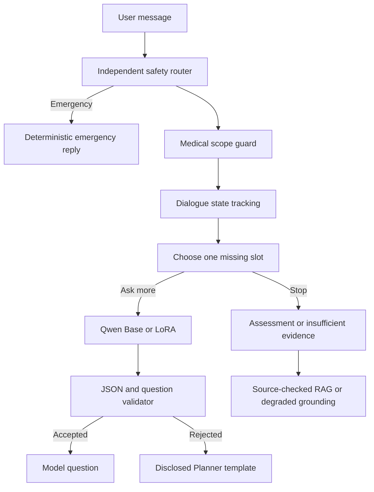

# Kiến trúc Middies Health AI

Mã nguồn được duy trì trên `main`, với hai runtime trong cùng repository. Backend nghiên cứu chính
nằm tại `qwen-rag-stack/backend/`; ứng dụng Express/React ở gốc vẫn được giữ để bảo toàn các chức năng hiện có.

## Thành phần

| Thành phần | Vị trí | Trách nhiệm |
|---|---|---|
| Ứng dụng React/Vite | `src/`, `server.ts` | Chat, quản lý hồ sơ, đọc tài liệu và trợ lý tương tác thuốc |
| Giao diện nghiên cứu | `qwen-rag-stack/app/` | Hiển thị trạng thái hỏi bệnh, nguồn phản hồi, bằng chứng và giới hạn |
| FastAPI | `qwen-rag-stack/backend/app/` | Safety, scope, DST, Planner, Qwen và RAG |
| Huấn luyện | `qwen-rag-stack/backend/training/` | Chuẩn bị dữ liệu có provenance, LoRA và kiểm tra adapter |
| Đánh giá | `evaluation/`, `qwen-rag-stack/backend/evals/` | Kiểm thử ứng dụng gốc, benchmark và closed-loop |
| Báo cáo | `qwen-rag-stack/docs/` | Protocol, cấu hình và kết quả thí nghiệm có bằng chứng |

## Chọn provider

Ứng dụng gốc gọi Gemini khi người dùng chọn chế độ cloud. Với chat `qwen_local`, Express chuyển
lịch sử sang `POST /api/v1/consultation` của FastAPI. Nếu Qwen không sẵn sàng, route này trả 503.
Chế độ benchmark chặn việc chuyển sang provider khác. OCR và tương tác thuốc vẫn thuộc luồng Gemini.

Hai giao diện có các dependency và lệnh chạy riêng. Giao diện nghiên cứu gọi FastAPI trực tiếp;
việc hợp nhất Git không biến hai runtime thành một backend duy nhất.

## Luồng nghiên cứu

Safety chạy độc lập với model/RAG. Dữ liệu đầu vào được phân định vai trò; validator kiểm tra định dạng,
target slot, nội dung lặp và các lỗi an toàn đã định nghĩa. API công khai provider, adapter và lý do fallback.
Các kiểm tra này là biện pháp của nguyên mẫu nghiên cứu, chưa phải chứng nhận an toàn lâm sàng.

## Tri thức và kết quả

Danh mục thuốc, mẫu Meddies và các quy tắc được lập trình trong `src/data/` hoặc `dialogue/knowledge.py`
không mặc nhiên là phác đồ đã được chuyên gia thẩm định. Tài liệu RAG giữ URL, phiên bản và trạng thái
kiểm tra nguồn; kiểm tra xuất xứ khác với rà soát lâm sàng. Không hiển thị phần trăm xác suất bệnh chưa hiệu chuẩn.

Model, dữ liệu xử lý, index, log và kết quả chạy cục bộ được Git ignore. Báo cáo E1–E5 đã công bố được
giữ nguyên; dọn code không ghi đè kết quả hoặc huấn luyện lại để thay đổi kết luận.

Chi tiết: [hướng dẫn nghiên cứu](qwen-rag-stack/docs/PLANNER_GUIDED.md),
[kết quả E5](qwen-rag-stack/docs/PLANNER_E5_RESULTS_20261031.md),
[hợp nhất và bảo trì repository](docs/REPOSITORY_MAINTENANCE.md).
