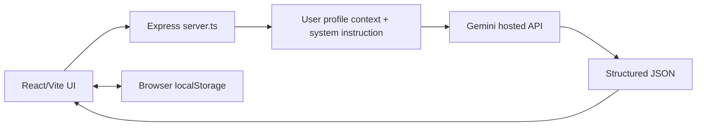
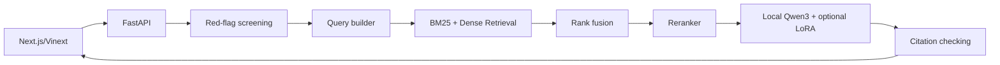

# Kiến trúc Middies Health AI sau hợp nhất

## Tổng quan

Repository lưu **hai hệ thống độc lập**, không phải một ứng dụng với hai model có thể chuyển đổi ngay lập tức. Việc hợp nhất Git nhằm bảo toàn mã nguồn và lịch sử phát triển; chưa có lớp API chung giữa hai ứng dụng.

| Khía cạnh | Gemini app (`/`) | Qwen/RAG (`/qwen-rag-stack`) |
|---|---|---|
| UI | React 19 + Vite | React + Next.js/Vinext |
| Backend | Express, `server.ts` | FastAPI, `backend/app/main.py` |
| Model | `gemini-3.8-flash` qua `@google/genai` | Qwen3 0.6B/1.7B (LoRA tùy cấu hình) |
| Suy luận | Hosted API | Local GPU / môi trường được cấu hình |
| Truy xuất tài liệu | Không triển khai RAG | BM25 + embedding BGE-M3 + RRF + reranker |
| Lưu hồ sơ | Browser localStorage | Luồng tư vấn riêng, xem tài liệu backend |
| Tác vụ | Chat, phân tích tài liệu, tương tác thuốc, quản lý hồ sơ | Tư vấn nhiều lượt, hỏi thêm, phân loại khẩn cấp, câu trả lời có dẫn nguồn |
| Đánh giá | `evaluation/` | `qwen-rag-stack/backend/evals/` |

## Luồng Gemini API

Ba API hiện có:

- `/api/health/chat`: xử lý triệu chứng và mức độ khẩn cấp `NORMAL`, `MONITOR`, `SOON`, `EMERGENCY`.
- `/api/health/analyze-doc`: phân tích hình ảnh/văn bản đơn thuốc và xét nghiệm.
- `/api/health/interactions`: hỏi đáp tương tác thuốc theo danh sách thuốc và bệnh sử.

Các endpoint đưa dữ liệu người dùng vào prompt rồi gọi Gemini. Backend chưa có nguồn dữ liệu dược lý được kiểm chứng hoặc RAG để xác thực tất cả suy luận lâm sàng. `src/data/medicationCatalog.ts` là danh mục tĩnh để tìm kiếm/gợi ý tên thuốc, **không phải** cơ sở dữ liệu kiểm chứng Drug–Drug Interaction.

Các file chính: `server.ts`, `src/App.tsx`, `src/components/`, `src/data/`, `src/utils/imageHelper.ts`.

## Luồng Qwen/RAG

Code nằm trong `qwen-rag-stack/`; xem `qwen-rag-stack/README.md` và `qwen-rag-stack/HUONG_DAN_TRAIN_VA_CHAY.md`. Pipeline đào tạo, tập dữ liệu và logic RAG thuộc hệ thống này; chúng **không** tự động cải thiện chất lượng Gemini API trong app gốc.

## Bộ dữ liệu và đánh giá

- `Meddies/meddies-consultant`: dùng làm nguồn hội thoại tổng hợp để tạo bài kiểm thử.
- `evaluation/meddies_eval.py`: lấy mẫu, loại bỏ nội dung `<think>`, tránh gửi `target_disease` vào model, gọi Gemini, đo thành công API/JSON/độ trễ và tạo biểu mẫu chấm chuyên môn.
- `qwen-rag-stack/backend/evals/`: các bộ kiểm thử và script dành riêng cho ứng dụng Qwen/RAG.

### Nguyên tắc đánh giá y khoa

Không suy ra clinical accuracy chỉ từ việc câu trả lời giống dữ liệu synthetic. Với phân loại cấp cứu, cần ground truth độc lập được chuyên gia xác minh; theo dõi emergency recall, under-triage, cảnh báo nguy hiểm và false-safe. Với đơn thuốc/xét nghiệm, đo lỗi tên thuốc, liều, chỉ số, đơn vị và những trường quan trọng.

## Rủi ro hiện tại

1. **An toàn y khoa:** mọi câu trả lời phải là hỗ trợ tham khảo; không nên dùng để thay bác sĩ hoặc tự động kê thuốc.
2. **Quyền riêng tư:** Gemini app lưu dữ liệu trình duyệt và gửi thông tin lên dịch vụ API; cần kiểm tra cơ chế đồng ý, xác thực, phân quyền, bảo vệ dữ liệu cá nhân.
3. **Tách biệt runtime:** `package.json` ở gốc và trong `qwen-rag-stack/` khác nhau; không chạy `npm install` tại gốc rồi giả định Qwen app đã có dependencies.
4. **Tương thích API:** Express và FastAPI hiện không dùng chung JSON schema hoặc API adapter.
5. **Chất lượng thực nghiệm:** trạng thái merge thành công không đồng nghĩa với việc các test đã chạy hoặc các model đã được xác nhận chất lượng.

## Định hướng tích hợp

Nếu muốn thống nhất thành một ứng dụng, trước tiên cần định nghĩa hợp đồng API cho `consultation`, `triage`, `document-analysis`, `medication-check`, sau đó xây dựng gateway chọn provider, lớp safety chung, phiên bản hóa knowledge base và benchmark dùng chung. Không nên ghép trực tiếp các cấu hình Node/Next/Cloudflare/Python hiện có vào cùng thư mục gốc.
